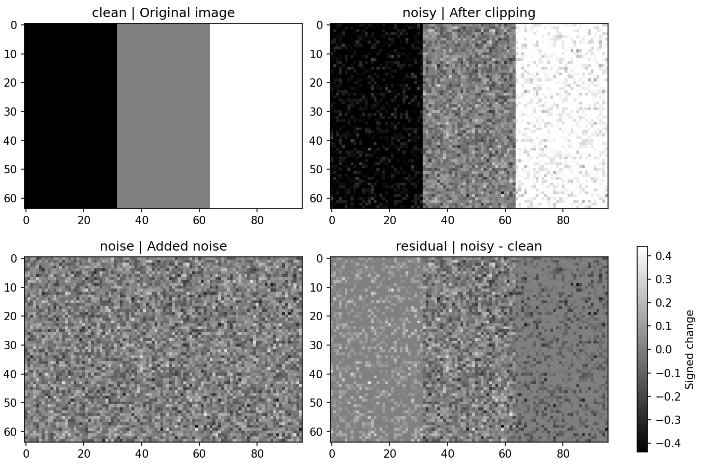
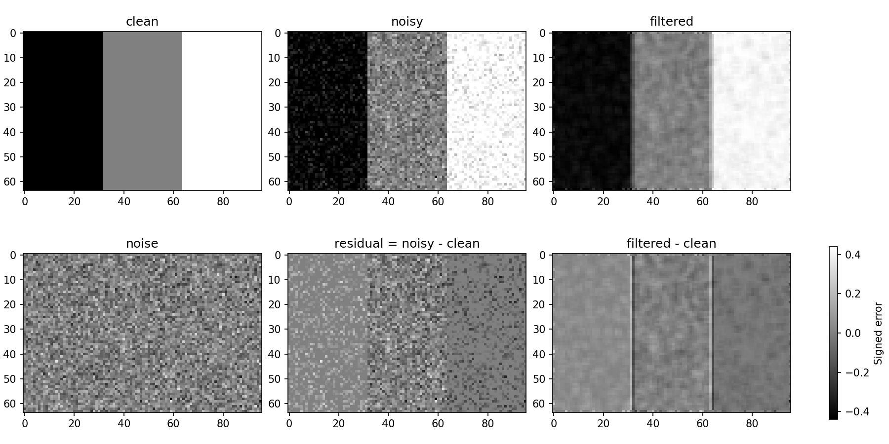
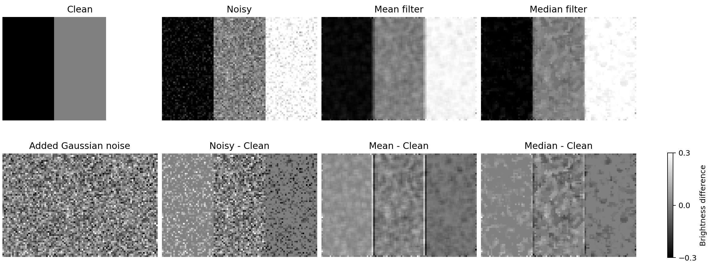

# GrayLab

## 概述

GrayLab 是一个灰度图像去噪实验项目，关注两个问题：去噪方法能在多大程度上减小像素误差？抑制噪声的同时，图像中的边缘和细节能保留多少？

项目计划从合成噪声入手，以干净图像作为参考，不同方法提供相同含噪输入。以未经处理的含噪图作为基线，结合误差指标和局部图像对照，比较各方法在平坦区域和边缘处的表现，分析它们在哪些条件下有效、又会损失哪些细节。

## 实验一 像素截断对合成高斯噪声的影响

### 我想验证什么？

在灰度图中，给不同亮度的像素加入同样分布的噪声之后，有的像素亮度值会超过最高值（纯白像素），有的像素亮度会低于最低值（纯黑像素），在灰度图中，像素的值有明确的值域，因此需要加入一个截断函数来抵消这种情况。

### 我怎么做的？
- 构造一张 64 × 96 的灰度图，黑、灰、白三条竖带的亮度依次为 0、0.5、1。
- 用 NumPy 为每个像素独立采样高斯噪声，均值为 0，标准差为 0.1，随机种子为 42。
- 将噪声加到原图上，用 `np.clip` 把结果限制在 [0, 1]。
- 计算 `residual = noisy - clean`，分别统计三个区域的带符号平均误差。

### 如何复现？

[查看实验代码](./gray_ready.py)

在安装了 NumPy 的 Python 环境中运行：

```bash
python gray_ready.py
```

### 我观察到了什么？

| 区域 |      带符号平均误差 |
|----|-------------:|
| 黑区 |     +0.03854 |
| 灰区 |     -0.00256 |
| 白区 |     -0.03905 |

### 实验一 结论



下排两图共用同一灰度范围，中灰表示零。截断后，黑区只保留非负误差，白区只保留非正误差，中灰区域的误差纹理与原始噪声基本一致。

在这张合成灰度图上，加入零均值高斯噪声并将像素值截断到 [0, 1] 后，黑区、灰区和白区的带符号平均误差分别为 +0.03854、−0.00256 和 −0.03905。

对纯黑像素，负扰动会使像素值低于 0，截断后回到 0，而正扰动会使像素变亮。对纯白像素，正扰动会使像素值超过 1，截断后回到 1，而负扰动会使像素变暗。因此，即使加入的噪声均值为零，截断仍会使纯黑区平均变亮、纯白区平均变暗。 中灰像素距离两个边界较远，在本次噪声强度下很少发生截断，其正负误差大致抵消，平均误差接近零。

## 实验二 3×3 均值滤波对平坦区域和边缘的影响

### 实验问题

对同一张含噪灰度图做 3×3 均值滤波，灰带内部和黑灰交界处的像素误差会怎样变化？

### 实验方法

沿用实验 01 的 64 × 96 黑、灰、白三条带图像。高斯噪声的均值为 0，标准差为 0.1，随机种子为 42，加噪后将像素值截断到 [0, 1]。

对每个内部像素，从含噪图 `noisy` 中取出以它为中心的 3×3 窗口，将 9 个像素的平均值写入输出图 `filtered` 的对应位置。最外一圈保留输入值，并从评价区域中排除。

以原图 `clean` 为参照，分别计算滤波前后同一区域的均方误差（MSE）。MSE 越小，表示该区域的像素整体越接近原图。

### 如何复现？

[查看实验代码](./gray_ready2.py)

在脚本所在目录打开终端。首次运行时，为当前 Python 环境安装依赖：

```bash
python -m pip install numpy matplotlib
```

运行实验：

```bash
python gray_ready.py
```

测试图由脚本生成，无需下载数据。使用脚本中的随机种子 `42`、噪声标准差 `0.1` 和 `3×3` 窗口运行，可得到下表中的四个 MSE 值（四舍五入到小数点后八位）。脚本末尾的绘图代码会显示原图、含噪图、滤波结果及误差图。

### 实验结果

| 评价区域  | NumPy 切片        |    滤波前 MSE |    滤波后 MSE |
|-------|-----------------|-----------:|-----------:|
| 灰带内部  | `[1:-1, 33:63]` | 0.01045944 | 0.00120178 |
| 黑灰交界  | `[1:-1, 31:33]` | 0.00725304 | 0.03187898 |

### 结论



对照 `noisy` 和 `filtered`，可以看到灰带内部的颗粒起伏减弱。这里每个窗口内的原始亮度都是 0.5，取平均时正负噪声可以部分抵消，MSE 降至滤波前的约 11.5%。

在误差图 `filtered - clean` 中，黑灰交界处出现一亮一暗的相邻竖线。第 31 列原本是黑色，滤波时混入灰侧像素，亮度偏高；第 32 列原本是灰色，混入黑侧像素后亮度偏低。在本次实验中，跨边缘取平均使亮度跳变变缓，交界处的 MSE 升至滤波前的约 4.40 倍。

## 实验三 3×3 中值滤波对平坦区域和边缘的影响

### 实验问题

对同一张含噪灰度图做 3×3 中值滤波，灰带内部和黑灰交界处的像素误差会怎样变化？与实验二的均值滤波相比，中值滤波能否更好地保留这条边缘？

### 实验方法

沿用实验 01 的 64 × 96 黑、灰、白三条带图像，三条带的亮度分别为 0、0.5 和 1。高斯噪声的均值为 0，标准差为 0.1，使用 `np.random.default_rng(42)` 生成，加噪后将像素值截断到 [0, 1]。

对每个内部像素，从含噪图 `noisy` 中取出以它为中心的 3×3 窗口，将 9 个像素按亮度从小到大排序，取第 5 个值，也就是中位数，写入输出图 `filtered` 的对应位置。最外一圈保留输入值，并从评价区域中排除。

在同一张含噪图上另外做一次 3×3 均值滤波，得到 `mean_filtered`，用于比较两种方法。两种滤波都从 `noisy` 读取窗口，结果分别写入各自的副本。

以原图 `clean` 为参照，分别计算未滤波、均值滤波和中值滤波后同一区域的均方误差（MSE）。MSE 越小，表示该区域的像素整体越接近原图。

### 如何复现？

[查看实验代码](./gray_ready3.py)

在脚本所在目录打开终端。首次运行时，为当前 Python 环境安装依赖：

```bash
python -m pip install numpy matplotlib
```

运行实验：

```bash
python median_filter.py
```

测试图由脚本生成，无需下载数据。使用脚本中的随机种子 `42`、噪声标准差 `0.1` 和 `3×3` 窗口运行，可以复现下表中的结果。脚本会显示第 10 行黑灰交界附近的亮度曲线，以及原图、含噪图、两种滤波结果和误差图，并将整图对比保存为同目录下的 `exp03_filter_comparison.png`。

### 实验结果

下表中的列索引从 0 开始，MSE 四舍五入到小数点后八位。

| 评价区域 | NumPy 切片        |    滤波前 MSE |  均值滤波后 MSE |  中值滤波后 MSE |
|------|-----------------|-----------:|-----------:|-----------:|
| 灰带内部 | `[1:-1, 33:63]` | 0.01045944 | 0.00120178 | 0.00184486 |
| 黑灰交界 | `[1:-1, 31:33]` | 0.00725304 | 0.03187898 | 0.00777851 |

### 结论



下排第一幅是截断前生成的高斯噪声，其余三幅分别是含噪图、均值滤波图和中值滤波图减去原图的误差。误差图中，中灰表示误差为零，越亮表示像素越偏亮，越暗表示像素越偏暗。

对照 `noisy` 和 `filtered`，可以看到灰带内部的颗粒起伏减弱。这里每个窗口内的原始亮度都是 0.5，取中位数可以减小局部噪声起伏，MSE 降至滤波前的约 17.6%。不过，本次实验中均值滤波在灰带内部的 MSE 更低，平坦区域的去噪效果更好。

在误差图 `mean_filtered - clean` 中，黑灰交界处出现明显的一亮一暗的相邻竖线；在 `filtered - clean` 中，这两条竖线较弱。边界附近的 3×3 窗口中，有 6 个像素来自中心像素所在的一侧，另外 3 个来自另一侧。与直接取平均相比，本次实验中取中位数减轻了另一侧亮度的影响，保留了更清晰的亮度跳变。例如，像素 `[10, 31]` 原本是黑色，真实亮度为 0，均值滤波后约为 0.224，中值滤波后约为 0.105。

本次实验中，中值滤波在黑灰交界处的 MSE 约为均值滤波的 24.4%，但仍比未滤波时高约 7.2%。因此，中值滤波相较于均值滤波减轻了这条边缘的模糊，但没有让交界处的整体像素误差降到滤波前以下。
